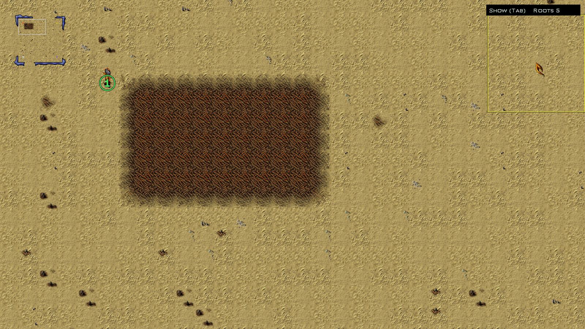
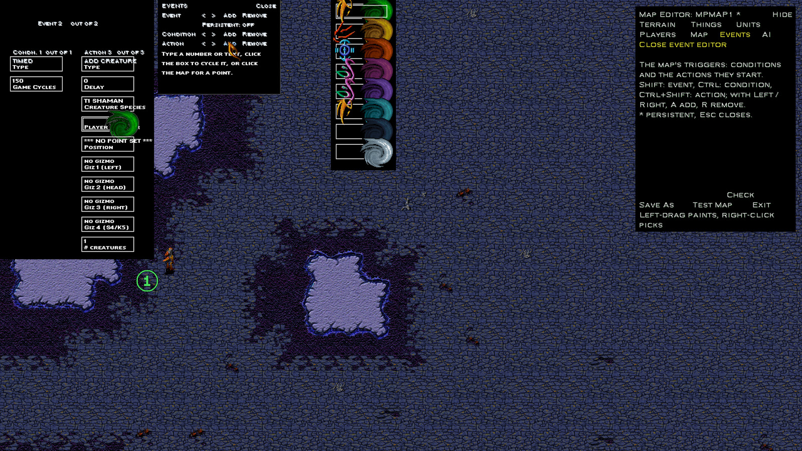
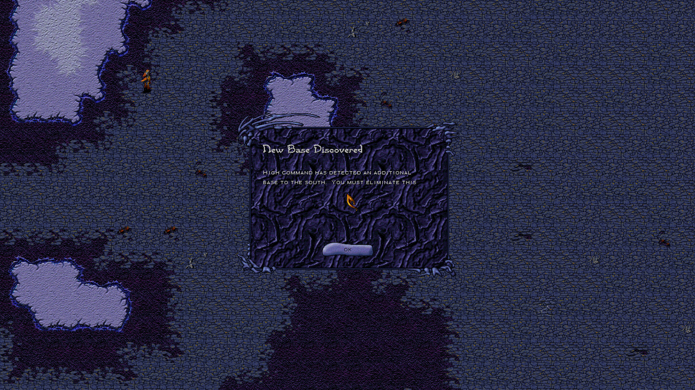
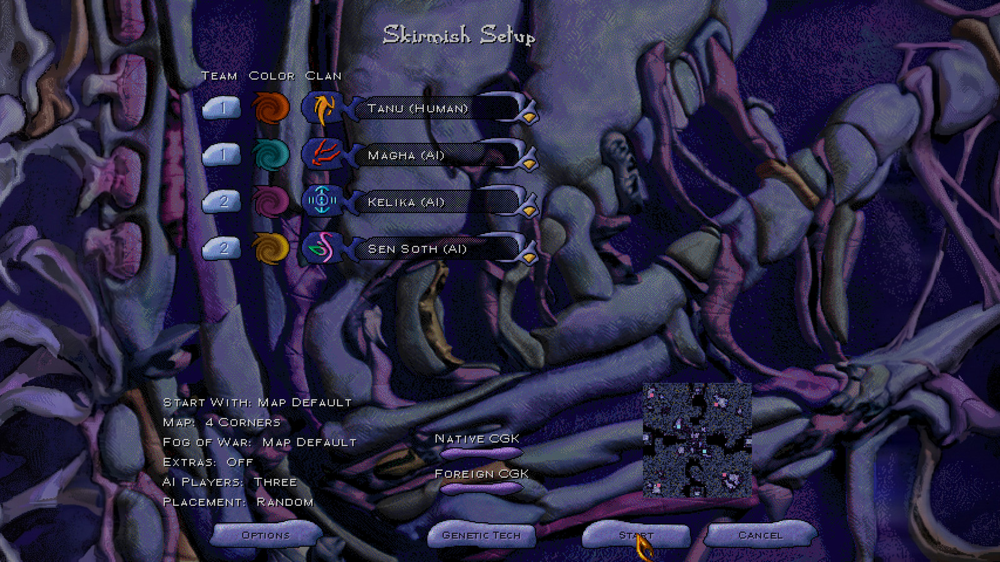
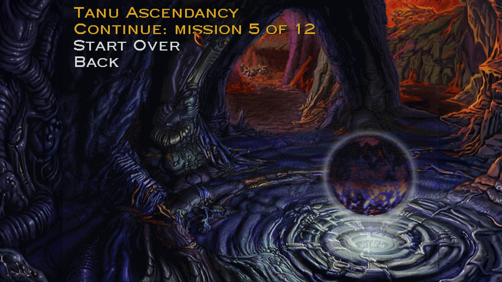
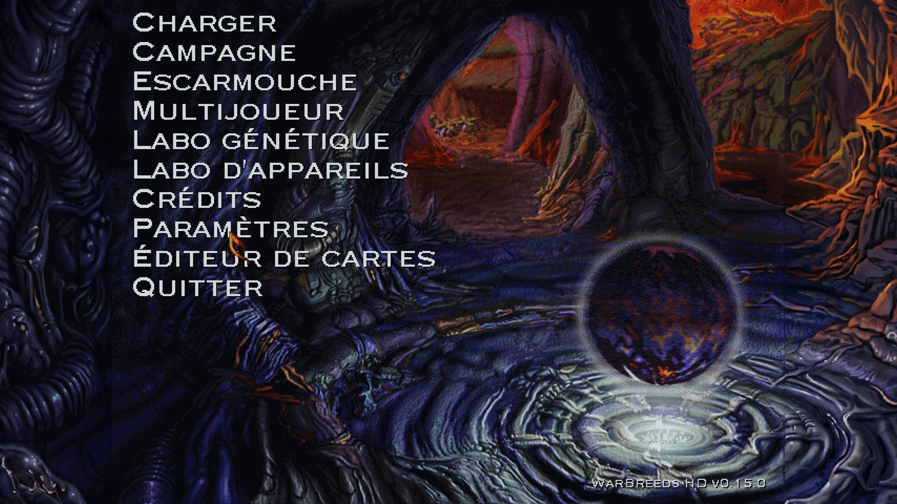
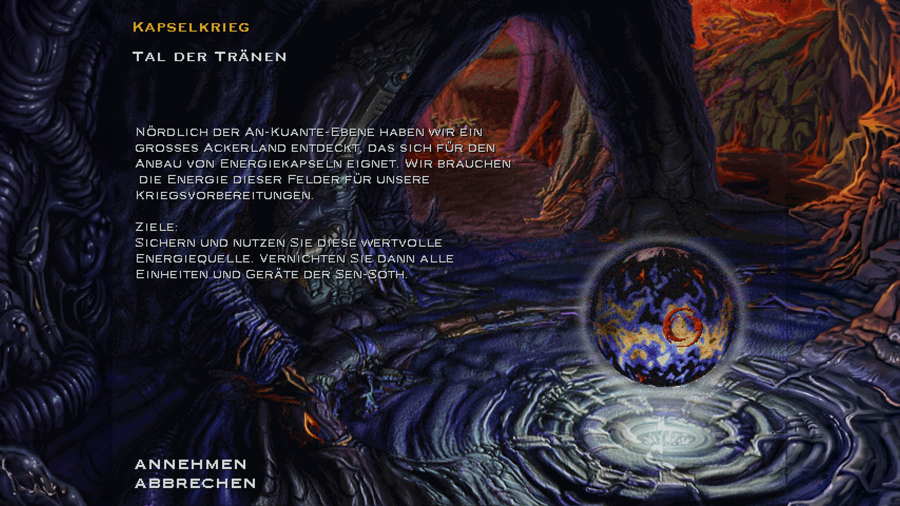

# WarBreeds HD

An unofficial patch that makes **WarBreeds** (Red Orb Entertainment, 1998) run well on modern Windows:
- native widescreen resolutions;
- smooth zoom;
- sharp scaling;
- windowed mode;
- working cutscenes;
- a Settings page;
- modern controls;
- units that find their way round walls, buildings and each other (improved pathfinding, or the original);
- the official map editor, built into the game;
- allied teams and colour choice in skirmish, and saving a skirmish;
- campaign progress that survives quitting;
- the game in French and German, or any language someone adds;
- the game's own multiplayer, working again.

It needs your own copy of the game, and has been tested with the GOG.com and Steam releases (they have the same game files).

The patch changes none of the game's files. It is a DLL that sits next to the game, so removing it puts everything back.

**[Download the latest release](https://github.com/Deadpoodle/warbreeds-hd/releases/latest)**, then follow the README inside the zip.


## Before and after

| Original (GOG release) | WarBreeds HD |
|---|---|
|  |  |
| The 640×480 menu with black bars | Widescreen art, Settings and Map Editor items, the version label |
|  |  |
| Missions at 640×480 | Missions at your desktop resolution |

| Zoomed out | Zoomed in |
|---|---|
|  |  |

| Settings page | Optional Orbitron font |
|---|---|
|  |  |


*The GIF and the zoomed shots are from a real skirmish (recorded in a 1920×1080 window). The before/after gameplay pair, the map editor, skirmish and campaign shots come from the automated test harness at 2560×1440; the gameplay pair has fog of war switched off (a debug option) so the terrain shows.*

## The map editor, inside the game

In 1998 Red Orb released the **WarBreeds Map Editor**, the tool its designers used to build every mission and skirmish map. It came as a separate, unsupported download (beta 1.0, March 1998): its own program, run outside the game, for an 800×600, 256-colour Windows 95 desktop.

Taking it apart showed that the editor is mostly the game itself. About 85% of its code is the WarBreeds engine, wrapped in a Windows editing shell, and that engine is already inside `WARBREED.EXE`. WarBreeds HD uses that to bring the editor into the game: **Map Editor** sits on the main menu next to Settings, and maps are made in the same engine, view and resolution that plays them.

| Pick a map, or start a new one | New Map: size, base terrain, players |
|---|---|
|  |  |

| The tools panel, top right (here the Players tab) | Folded away with Tab, with the brush outline |
|---|---|
|  |  |

**Smart painting, as the designers had it.** The original editor's Smart Palette picks the right border tile for every cell from the terrain at its four corners, so a stroke of Sand on Crystal comes out with the same ragged, hand-drawn edges as the shipped maps. WarBreeds HD rebuilds that painter from the original editor, using the transition tables in your own game's data:
- checked against all 54 shipped maps, 99.99% of their tiles are exactly what the painter picks for their corners, and test painting on them leaves no seams;
- the original's rules are kept: a terrain only goes next to terrain it has border art for (Lava with Tar, Cropland with Crushed Crystal, Hardened Tar or Roots). Where the old editor only said "You cannot paint that there", a refused stroke now says what is in the way.

| Before | After three strokes: Crushed Crystal, Crystal, Sand |
|---|---|
|  |  |

**Working on a map**
- Any map opens in the normal game view, frozen and without fog. The camera, smooth zoom and minimap work as in a mission. The tools panel sits in the top-right corner, keeps its size at any zoom, and folds to a one-line strip with Tab, so you can paint behind it with the same tool.
- Brushes of 1, 2, 3 or 5 cells, with an outline at the cursor of the cells a stroke will paint; Shift+drag fills a rectangle; right-click picks up the terrain under the cursor; Ctrl+Z and Ctrl+Y undo and redo every change.
- **Things**: trees and rocks on their own ground (crushed crystal, roots, hardened tar), Yedda ruins, pods, spores and weeds; Fill Cropland and Clear Crops as in the original.
- **Units**: creatures and devices for any player, placed by the game's own code (devices complete, powered or not). Select a thing to drag it elsewhere, delete it, or set its hit points, veteran rank and gizmos.
- **Players**: type (computer, human, either, none), race, CGK level and available clans per player, and start points, shown on the map as numbered rings in the player's colour.
- **Map**: name, fog mode, players supported and recommended.
- **Check** lists what may be wrong with a map, which the original never did: missing start points or Shamans, devices without power, start points cut off from each other on foot, and more. Saving runs it too, and only warns.
- **New Map**: 32 to 96 cells per side, a base terrain, 2 to 8 players, each starting with a Shaman.
- **Save As** runs the game's own map processing (the pathfinding guide graph the original editor built on save), then writes the map to `DATA\MAPS`, where the skirmish setup lists it. The built-in maps are never overwritten: edit one and it's saved under a new name.
- **Test Map** saves and starts a skirmish on the map. It asks first, so click it twice.

- **Events**: the original's event (trigger) editor, the game's own screen for it, which shipped inside the retail game with no way to open it. Conditions (timers, positions, deaths, devices, and more) start actions (dialogs, messages, reinforcements, victory or defeat, and more); the Events tab opens it, with buttons for adding, removing and stepping through events, conditions and actions.
- **Global AI**: each computer player's squad, base, scouting and influence settings. **A skirmish on a map you made uses these settings.** In the original game a skirmish always replaced them with each clan's default aggression, so a map's own AI settings never applied; WarBreeds HD keeps them for your maps. The game's own skirmish maps still use the clan defaults, so they play exactly as they always have. An AI AGGRESSION event can change the settings during play.

| The event editor (the game's own, never reachable until now) | An event firing in a test skirmish |
|---|---|
|  |  |

**Still to come**: the original's terrain-specific palettes (placing border tiles by hand), palette thumbnails, and campaign maps (see [docs/nice-to-have.md](docs/nice-to-have.md)).

## Skirmish teams, saves and campaign progress

| Skirmish setup with teams and colours | Picking a campaign back up |
|---|---|
|  |  |
| Click a row's team or colour to change it | Clicking a campaign you've started offers to continue |

**Teams in skirmish.** The skirmish setup gets the Team and Color columns the multiplayer lobby has always had. Click a row's team badge to cycle it through none, 1, 2, 3 and 4. Players on the same team are allied: they don't attack each other, they help each other in fights, and the team wins together. The computer players follow the alliances too. Leave every team at none and the skirmish is the original: all computer players allied against you.
- With Random placement, teammates start near each other.
- If you're wiped out while a teammate is still fighting, you watch the rest of the battle with the map revealed. The result screen shows Victory if your team wins.
- The game won't start with everyone on one team ("All players are allied.").

**Colours in skirmish.** Click a row's colour to choose it; right-click to go back to automatic. Each colour can only be used once. Rows left on automatic get the game's own colours (each clan's colour first), moving aside if you picked theirs. A row with a Random clan gets its colour when the game starts.

**Saving a skirmish.** The Esc menu in a skirmish now has Load Game and Save Game, as in a campaign. The original game could save a skirmish all along but left the two buttons out, and a saved skirmish would have come back under campaign rules: the first player as you, clan colours instead of the ones you chose, and the result screen leading to the main menu. WarBreeds HD writes a small `<name>.wbs.hd` beside each skirmish save (who you were, the skirmish setup and where you were looking), and a skirmish save loads as a skirmish, teams and all, from the Esc menu or the main menu. The `.wbs` itself is the game's own format. Keep the two files together (copying a save to another PC, for instance): without its `.hd`, a skirmish save loads as the original game would load it. While you watch an ally after your own defeat, Save Game isn't available.

**Skirmish objectives.** The Esc menu's Objectives lists every enemy to defeat ("Defeat the Kelika"), with a green check beside each one you have beaten. The original showed "no explicit objectives".

**Campaign progress.** The original kept campaign progress only while the game was running; quitting meant starting the campaign again. WarBreeds HD remembers where each campaign (Tanu Ascendancy, Magha Uprising) is every time a mission briefing opens, in `WarBreedsHD-progress.ini` next to the game. Click that campaign again and choose **Continue** to go straight to that mission's briefing, or **Start Over**. Nothing carries over between WarBreeds missions anyway, so continuing loses nothing. Finishing a campaign clears its record. Saved games work as before.

## Languages

WarBreeds HD can show the whole game in another language: menus, unit and device names, map names, briefings, the result screens, the credits' titles, and WarBreeds HD's own Settings page and map editor. Pick it on the main menu's **Settings > Interface > Language**; it changes at once.

| French main menu | A German briefing |
|---|---|
|  |  |

- **French and German come with the patch.** Their game text, map titles and messages, and unit and building names are the 1998 French and German releases' own (used with the original developers' blessing), extracted from those CDs with [tools/locale_extract.py](tools/locale_extract.py) ([re/french-version.md](re/french-version.md), [re/german-version.md](re/german-version.md)). WarBreeds HD's own text in both was drafted by machine (an AI model), so expect clumsy wording here and there: corrections are very welcome (open an issue, or send a fixed file).
- **Any language can be added without changing the patch.** Each language is a plain text file in the `Lang` folder, `WarBreedsHD_<code>.txt`; the Settings page lists whatever files it finds. `Lang\README.txt` in the zip explains the format, and the game writes a ready-to-fill template into that folder each time it starts, made from your own copy (every line with its English).
- **The font follows the language.** The 1998 French release drew its text in narrower TrueType fonts than the English bitmap faces, and its text is written for them. In French and German (both releases used the same fonts), WarBreeds HD uses those fonts if you have them: copy them from the CD's `FONTS` folder into the game's `Fonts` folder (or install them). The few text boxes the release resized for them (the Device Lab's and Gene Lab's, the briefing's) are then the release's too. Otherwise the menus use Roboto Condensed (close to the release's Bell Gothic, narrowed to the 1998 width where needed). The HUD, the labs and the headings keep the English game's own pixel fonts, which read best at those small sizes, with the few tight spots ("Construire") set a pixel tighter. The 1998 interface face was too small to read at 1080p. A language's fonts are a small file beside its text, `Lang\WarBreedsHD_<code>.fonts`, made by [tools/font_metrics.py](tools/font_metrics.py).
- Other languages use the game's own bitmap fonts, which already hold the accented Western European letters (é, ç, ü, ß ...), in an older Mac order the patch maps to. The Orbitron font option is for English only.
- The movies stay English, and so does the text players type (the game only accepts plain letters there).

### French or German voices

The spoken announcements ("construction complete", "unit lost", ...) can play in French or German, taken from your own copy of that version of the game. No game audio comes with the patch, and the English voices of your Steam or GOG copy are never changed.

All the announcements are in one file, `GLOBSFX.MHK`. The sound effects file, `SFX.MHK`, is the same in every version.

1. **Find the file** on your French or German WarBreeds CD (or a disc image of it): `WARBREED\DATA\GLOBSFX.MHK`. The French one is about 4.5 MB and the German about 4.3 MB; the English one is about 3.9 MB.
2. **Make a folder** in your WarBreeds game folder (the one with `WARBREED.EXE`): `Voices`, and inside it a folder named after the language: `fr` for French, `de` for German.
3. **Copy the file** into it, keeping its name:

   ```
   WarBreeds\                  your game folder
     WARBREED.EXE
     DATA\GLOBSFX.MHK          the English voices: leave this one alone
     Voices\
       fr\GLOBSFX.MHK          from the French CD
       de\GLOBSFX.MHK          from the German CD
   ```

   Don't replace `DATA\GLOBSFX.MHK`. It is the English set, and it is still used whenever English voices are chosen.
4. **Pick the voices** on the main menu: **Settings > Interface > Voices**.
   - **By language** (the default): the voices of the language the game is shown in, if you have them, else English.
   - **English**, or any language you've added: those voices, whatever the text language.

   The change is immediate. A file that isn't a WarBreeds `GLOBSFX.MHK` is ignored (the log, `WarBreedsHD.log`, says so) and English plays instead.

## What it does

**Display**
- Missions run at your desktop resolution (or one you pick), in any shape: 16:9, 16:10 or 21:9.
- Scaling is crisp, through our own Direct3D 11 presenter.
- Borderless fullscreen or a resizable window; Alt+Enter switches between them.
- Smooth mouse-wheel zoom towards the cursor. The interface stays one size while the battlefield zooms.
- The interface is sized so every panel fits the window, even the tallest (the Gene Lab+'s Select Components with all 15 components), and panels stay put at every zoom.
- Widescreen menu screens. A setting brings back the original 4:3 art for anyone who'd rather not see AI-extended artwork.
- F2 shows a frame-rate counter.

**Cutscenes**
- The movies play again. The game needed QuickTime 2 for Windows; the patch replaces it with its own Cinepak/IMA4 player.
- Movies are upscaled on the GPU, with a choice of three scaling modes: Enhanced, Smooth and Sharp.

**Settings page**
- A native Settings item on the main menu, with Video, Controls and Interface tabs.
- Changes are saved and applied immediately.

**Map editor** (more in [The map editor, inside the game](#the-map-editor-inside-the-game))
- The official 1998 editor on the main menu: edit any map or make a new one, with the original's smart painting, trees, rocks, crops, units, devices, players, start points, map settings, events (triggers) and Global AI, undo for all of it, and a map check.
- Save As processes the map for pathfinding and saves it where the skirmish setup finds it; Test Map (asks first) plays it.

**Skirmish** (more in [Skirmish teams, saves and campaign progress](#skirmish-teams-saves-and-campaign-progress))
- Teams: allied sides chosen on the setup screen, for you and the computer players. Teammates start together and win together.
- Colours: choose each player's colour; right-click for automatic.
- Load Game and Save Game on the Esc menu; a saved skirmish loads as a skirmish.

**Campaign**
- Progress is kept between sessions: a campaign you've started offers Continue or Start Over.

**Languages** (more in [Languages](#languages))
- French and German, switched live on the Settings page; more by adding a text file to the `Lang` folder.

**Multiplayer**
- The main menu's Multiplayer works again: the game's own LAN and Internet play over TCP/IP, for up to four players. On the GOG release it only showed an error. GOG's DirectPlay workaround couldn't load DirectPlay, and earlier versions of WarBreeds HD also left Windows COM set up in a way the game's network start-up rejected. Both are fixed.
- Every player needs WarBreeds HD (all on the same version) and Windows' DirectPlay feature.
- One player picks Internet TCP/IP, then Create. The others pick Join and type the host's IP address. The host may need to allow WARBREED.EXE through Windows Firewall. IPX, the other 1998 option, doesn't exist on modern Windows.
- **Internet play without a VPN:** every player must be reachable on TCP/UDP 47624 (the host) and 2300-2400. WarBreeds HD asks each router to forward those ports (UPnP), and corrects the private addresses players behind a router send. Players behind their provider's own NAT (CGNAT) can still join but not be reached for hosting; a virtual LAN (ZeroTier, Tailscale, Hamachi) always works. `WarBreedsHD.log` says what UPnP did. Without UPnP, forwarding **UDP 47624** to the host's PC is enough (confirmed by players). Ports 6073 and 41624, seen in some guides, aren't used.
- **One DirectPlay:** GOG's and Steam's `dplayx.dll` in the game folder is a stub. The game's own import and DirectPlay's TCP/IP provider used to bind to it alongside Windows' real DirectPlay. Both now use Windows' DirectPlay. A crash in multiplayer writes `crash:` lines to the log and `WarBreedsHD-crash.dmp`.
- Tested with two copies on one PC; games between PCs over the internet are being tested. Reports are welcome.

**Controls** (the full list is in [docs/controls.md](docs/controls.md))
- Arrow keys scroll smoothly. Optional WASD.
- Unit groups: double-tap a number to centre on the group; Shift+number adds the group to the selection.
- Shift+drag adds a box of units to the selection.
- Quick-build: B, then a letter (R Refinery, T Turret, …); P, then 1–3 for pods.
- Builders clicked onto your own unfinished or damaged building go and finish or repair it.
- Group build: with several builders selected, the build, plant and repair buttons and keys still work. They all build it: with Improved pathfinding they start it together; with Original the nearest starts it and the others help once it stands.
- Placing a Refinery, Relay, Relay+, Turret, Plasma Cannon or Electric Tower shows its range ring at the cursor, in the game's own style: what a Refinery collects, what a Relay powers, how far a turret picks targets by itself. Settings > Controls > Placement Range.
- Pods can be planted in fog: the Shaman walks there and plants.
- An optional **Modern mouse scheme**: left-click selects, right-click gives orders. Classic is the default.
- Alt+F4 quits.

**Pathfinding** (Settings > Controls > Pathfinding: Improved, the default, or Original)
- Units plan their whole route across the map, around rocks, cliffs, water and buildings. The 1998 planner only looked a few tiles ahead, so units walked into U- and C-shaped dead ends and jittered there.
- Units know the map's terrain and rocks even under fog. They learn about enemy buildings when they see them, and replan as soon as one blocks the way.
- A click on a spot units can't reach (rocks, water, inside a building, an island) sends them to the nearest spot they can reach, where they stop. The original kept them trying, and loosened what counted as "arrived" until they gave up.
- A group gets a spot each, in a loose cluster around the click, instead of all fighting over one point. Formation moves (Space) are unchanged.
- Traffic: a unit asks an idle friend in its way to step aside. In a jam it waits about a second, then goes another way if that isn't much longer. Two units meeting head-on in a narrow pass don't deadlock: one goes round. A unit that makes no progress for 10 seconds stops.
- Building sites: once a builder is on its way to build, the player's other units keep off the site, so a unit standing in the way can't make the building fail. An idle unit already on it steps off.
- Group build together: with several builders selected, every one of them walks to the site, takes its own spot round it with the build animation, and they start the building together (four builders start it in about a quarter of the time). When it stands they all build it on. With Original, the others wait beside the site until the first stage is up, as before.
- Units walk at their original speeds; only the routes change. Flyers fly as before.
- Also fixes the 1998 collision bug that misread which tiles are blocked (a stale value on every other row of tiles), and the one that let units and buildings onto animated water.
- Applies to every unit, the computer players' too. Takes effect from the next mission. In multiplayer everyone uses the host's choice; if any player has an older WarBreeds HD, the game uses Original.

**Fixes**
- Pins the game to one CPU core. The 1998 timer code hangs on multi-core CPUs, and GOG's build does the same. Each running copy takes a core of its own, so two copies on one PC don't slow each other down.
- Removes the in-mission resolution slider, which fought the new resolution handling.
- Fixes a 1998 crash in long games: the remembered picture of a building seen earlier, refreshed when its ground comes back into view, could read from a different unit once that building was destroyed out of sight and its number reused, and divide by zero.
- A mission, and a loaded game, starts centred on your base (it used to sit up and to the left at HD sizes).
- Loading a campaign save from inside a skirmish no longer sets the loaded game up as a skirmish.
- Redraws the whole battlefield every frame. The original only redrew what it had marked as changed, and fast flying units left trails of old copies behind them.

**Fonts**
- An optional modern font for English, Orbitron, which switches live. Text that would run wider than the original font is narrowed to fit, so titles stay inside their bars. It isn't meant for translations: in other languages the font follows the language (see Languages).

## Install

1. Download the zip from [Releases](https://github.com/Deadpoodle/warbreeds-hd/releases/latest).
2. Copy `wsock32.dll`, `Fonts\`, `Menus\` and `Lang\` into your WarBreeds folder, next to `WARBREED.EXE`. On Steam, right-click WarBreeds in your library, then Manage > Browse local files.
3. Start the game. The main menu shows the version at the bottom right and a new Settings item.

To uninstall, delete those files plus `WarBreedsHD.ini`, `WarBreedsHD-progress.ini` and `WarBreedsHD.log`, and any `*.wbs.hd` files in `DATA\Saves` (skirmish saves then load as the original game would load them). The zip's README.txt has the details, including notes for Linux, which hasn't been tested yet.

## Building from source

The patch is a 32-bit DLL, built with MinGW-w64.

**Windows (MSYS2):**
```bash
pacman -S mingw-w64-i686-gcc
```
```bash
sh build.sh
```
The DLL lands in `build/wsock32.dll`.

**Linux (cross-compiling):**
```bash
CXX=i686-w64-mingw32-g++ ./build.sh
```

To make a release zip, run `python tools/package.py`. It needs Pillow, and takes the menu art from a folder of PNGs (`--art DIR`).

## How it works

The game imports `WSOCK32.dll`, so a proxy `wsock32.dll` in the game folder is loaded at start-up. It forwards the real Winsock calls and patches the game in memory, with no edits to `WARBREED.EXE`. Everything was found by reverse engineering the 1998 executable: [docs/reverse-engineering.md](docs/reverse-engineering.md) is the guide to that work (tools, methods, conventions) and a log of what was found, for anyone working on WarBreeds or a similar game.

| Path | What's there |
|---|---|
| `src/` | The patch: renderer (`render/`), zoom, interface layers, menu and Settings page, controls, the improved pathfinding (`pathing.cpp`, `pathing_nav.cpp`), fonts, cutscene player (`movie/`), map editor (`editor/`), skirmish teams and AI settings, campaign progress, the multiplayer fix |
| `tools/` | The headless test harness (`autotest.sh`, `mptest.sh`, `smoke.ps1` and the `*_check.py` checkers), the Ghidra scripts (`ghidra/`), the disassembly helper (`wbre.py`), Mohawk `.MHK` image extraction (`mhkimg.py`), the map file reader (`wbm.py`), the menu-art pipeline, packaging |
| `re/` | Reverse-engineering reports, indexed by [re/subsystems.md](re/subsystems.md), and the name and type databases (`names.tsv`, `types.tsv`) |
| `docs/` | The [reverse-engineering guide and log](docs/reverse-engineering.md), the controls reference, the [nice-to-have list](docs/nice-to-have.md) and screenshots |

The patch includes a debug autopilot and a headless mode, so most testing ran hidden, with scripted input and screenshots, while the game was played normally on the same PC.

## Licence

The WarBreeds HD code, tools and documentation are released into the **public domain** ([The Unlicense](LICENSE)): do whatever you want with them.

Not covered:
- **Fonts** (Orbitron, Roboto Condensed): under the SIL Open Font License.
- **The French game text** in `lang/WarBreedsHD_fr.txt` (`[game]`, `[maps]`, `[messages]`): the 1998 French release's own, included with the original developers' blessing.
- **WarBreeds itself:** © 1998 Red Orb Entertainment / Broderbund. No game files are included.
- **Widescreen menu artwork in the releases:** derived from the game's original art.

This is an unofficial fan project, not affiliated with or endorsed by the rights holders.
