# WarBreeds HD

An unofficial patch that makes **WarBreeds** (Red Orb Entertainment, 1998) run well on modern Windows:
- native widescreen resolutions;
- smooth zoom;
- sharp scaling;
- windowed mode;
- working cutscenes;
- a Settings page;
- modern controls;
- the official map editor, built into the game.

It needs your own copy of the game, and has been tested with the GOG.com release.

The patch changes none of the game's files. It is a DLL that sits next to the game, so removing it puts everything back.

**[Download the latest release](https://github.com/Deadpoodle/warbreeds-hd/releases/latest)**, then follow the README inside the zip.

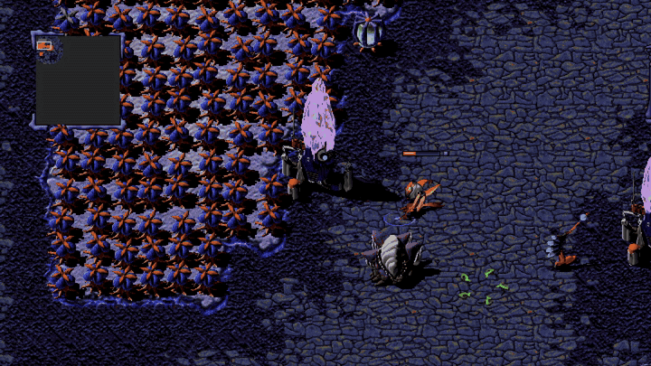

## Before and after

| Original (GOG release) | WarBreeds HD |
|---|---|
| 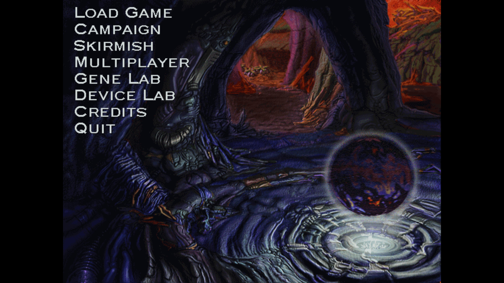 | 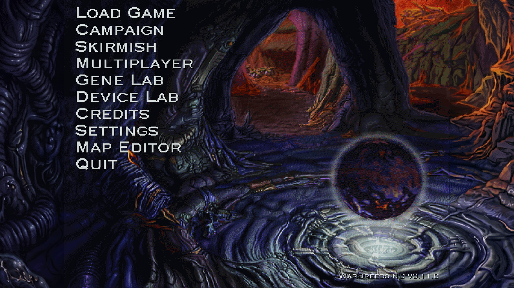 |
| The 640×480 menu with black bars | Widescreen art, Settings and Map Editor items, the version label |
| 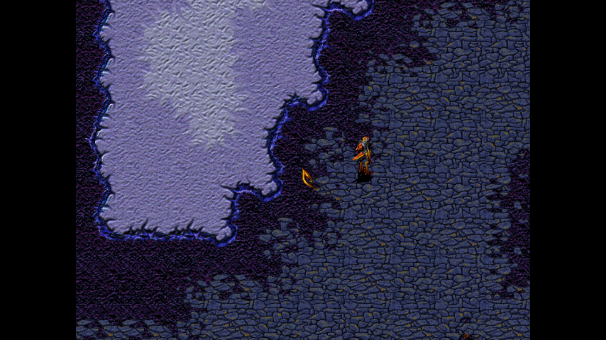 | 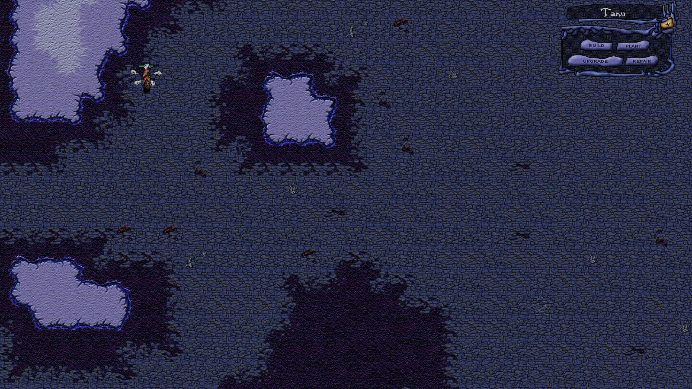 |
| Missions at 640×480 | Missions at your desktop resolution |

| Zoomed out | Zoomed in |
|---|---|
| 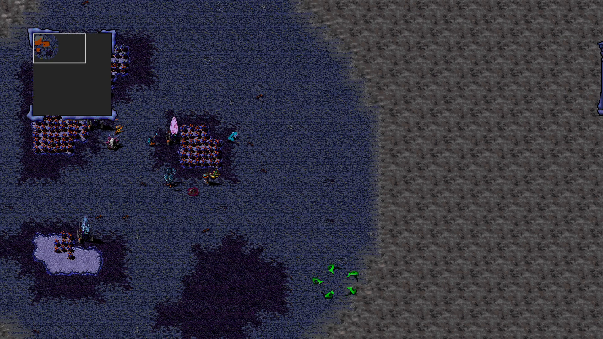 | 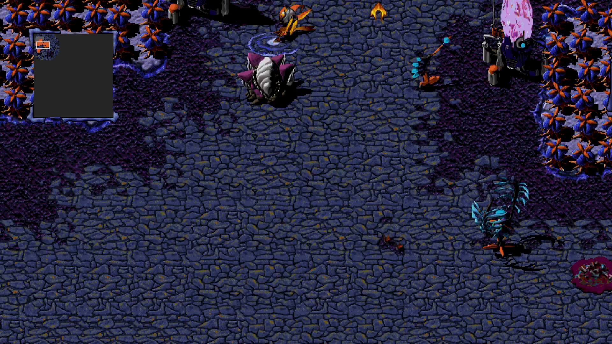 |

| Settings page | Optional Orbitron font |
|---|---|
| 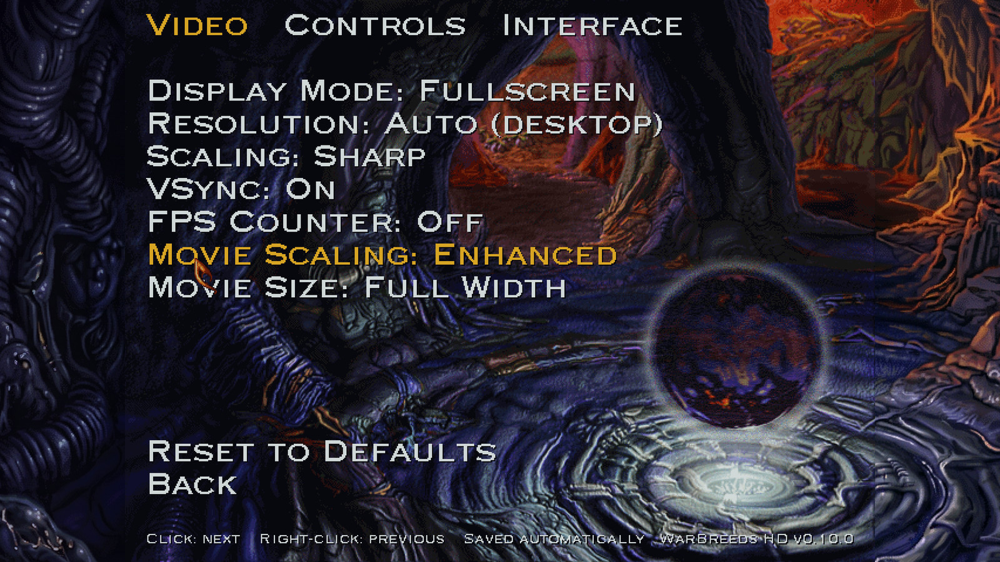 | 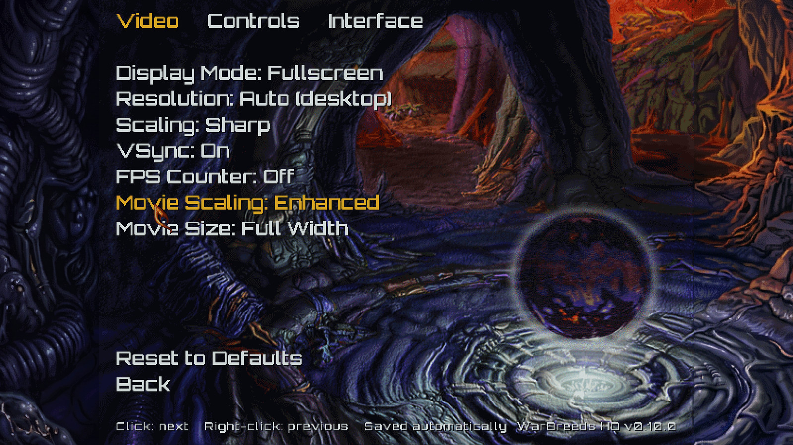 |

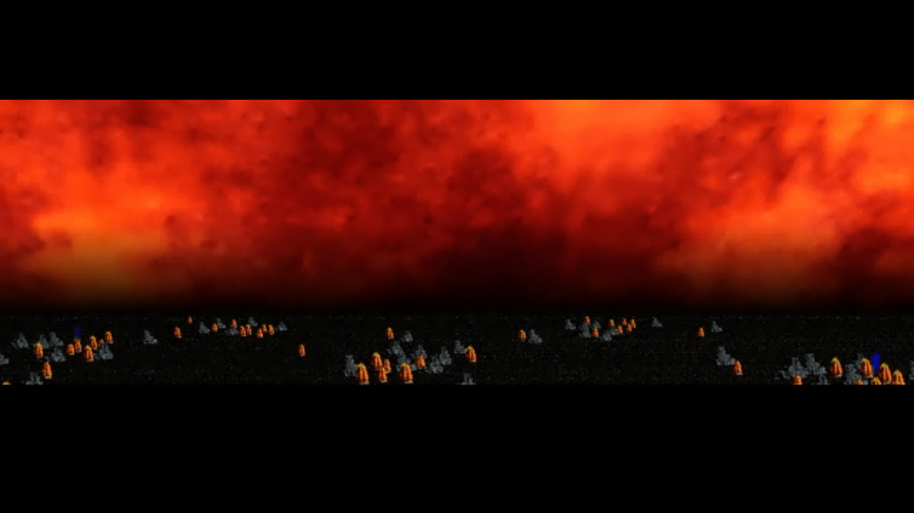

*The GIF and the zoomed shots are from a real skirmish (recorded in a 1920×1080 window). The before/after gameplay pair and the map editor shots come from the automated test harness at 2560×1440; the gameplay pair has fog of war switched off (a debug option) so the terrain shows.*

## The map editor, inside the game

In 1998 Red Orb released the **WarBreeds Map Editor**, the tool its designers used to build every mission and skirmish map. It came as a separate, unsupported download (beta 1.0, March 1998): its own program, run outside the game, for an 800×600, 256-colour Windows 95 desktop.

Taking it apart showed that the editor is mostly the game itself. About 85% of its code is the WarBreeds engine, wrapped in a Windows editing shell, and that engine is already inside `WARBREED.EXE`. WarBreeds HD uses that to bring the editor into the game: **Map Editor** sits on the main menu next to Settings, and maps are made in the same engine, view and resolution that plays them.

| Pick a map, or start a new one | New Map: size, base terrain, players |
|---|---|
| 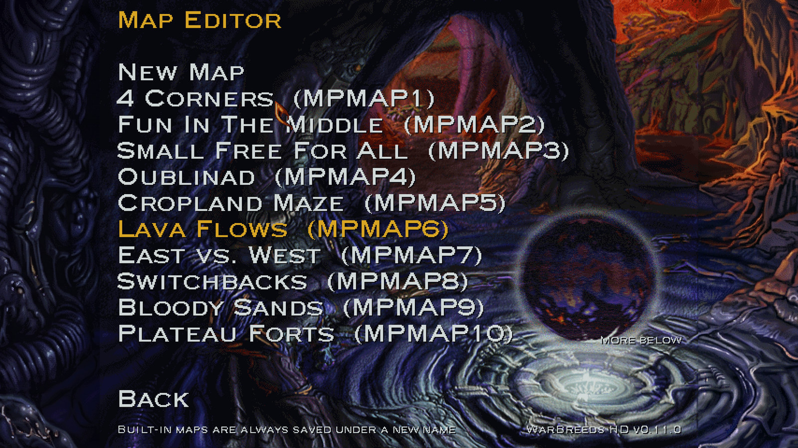 | 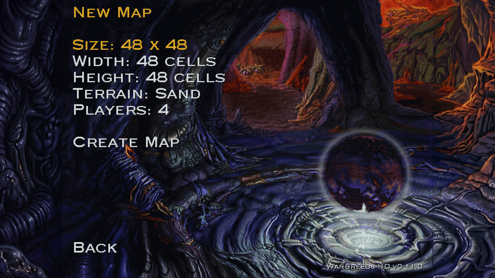 |

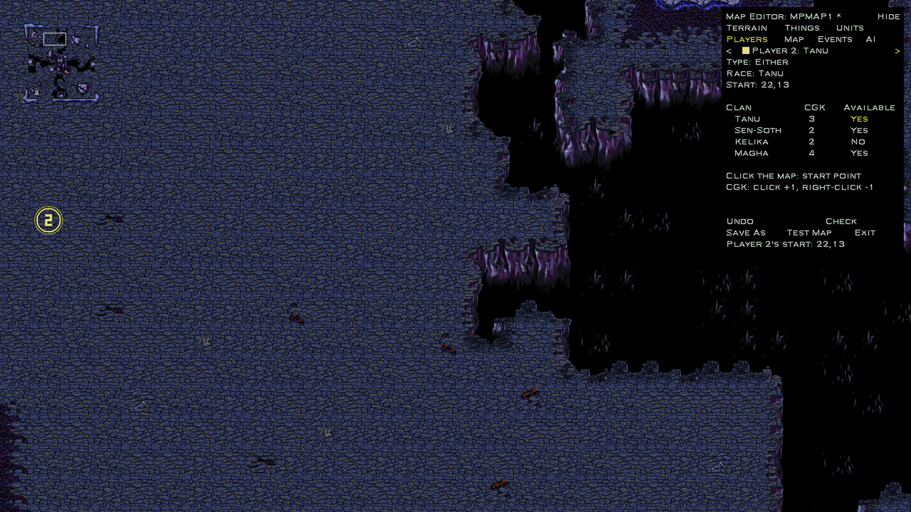

**Smart painting, as the designers had it.** The original editor's Smart Palette picks the right border tile for every cell from the terrain at its four corners, so a stroke of Sand on Crystal comes out with the same ragged, hand-drawn edges as the shipped maps. WarBreeds HD rebuilds that painter from the original editor, using the transition tables in your own game's data:
- checked against all 54 shipped maps, 99.99% of their tiles are exactly what the painter picks for their corners, and test painting on them leaves no seams;
- the original's rules are kept: a terrain only goes next to terrain it has border art for (Lava with Tar, Cropland with Crushed Crystal, Hardened Tar or Roots). Where the old editor only said "You cannot paint that there", a refused stroke now says what is in the way.

| Before | After three strokes: Crushed Crystal, Crystal, Sand |
|---|---|
| 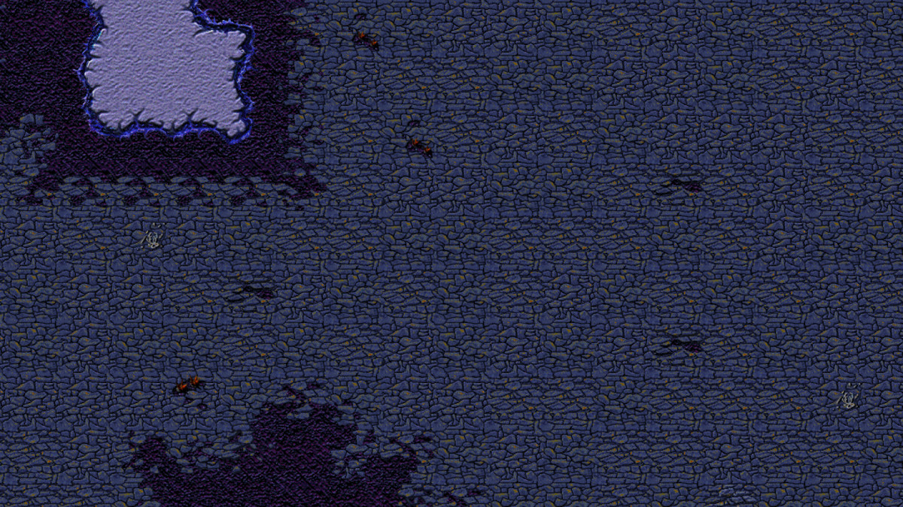 | 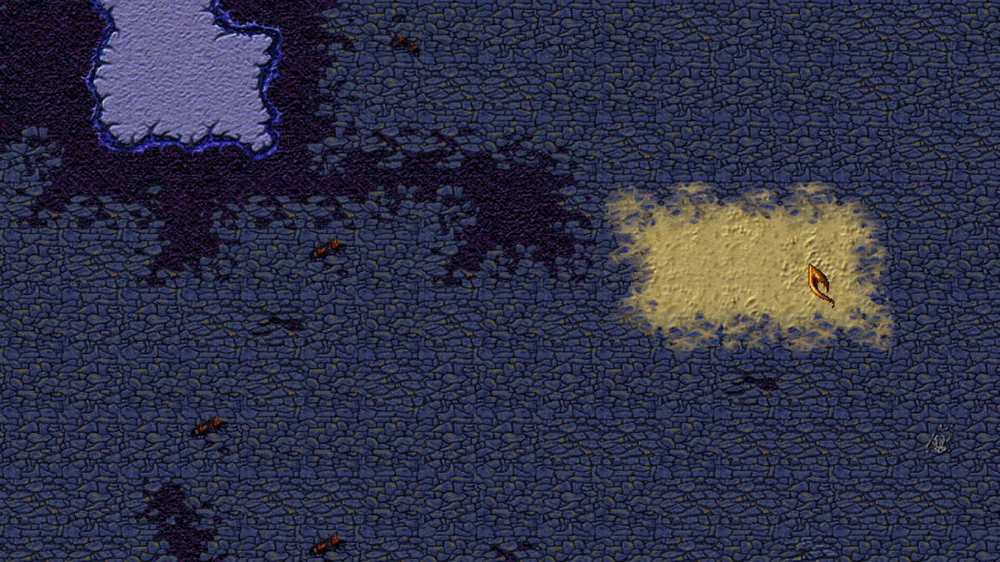 |

**Working on a map**
- Any map opens in the normal game view, frozen and without fog. The camera, smooth zoom and minimap work as in a mission. The tools panel sits in the top-right corner, keeps its size at any zoom, and folds to a one-line strip with Tab, so you can paint behind it with the same tool.
- Brushes of 1, 2, 3 or 5 cells, with an outline at the cursor of the cells a stroke will paint; Shift+drag fills a rectangle; right-click picks up the terrain under the cursor; Ctrl+Z and Ctrl+Y undo and redo every change.
- **Things**: trees and rocks on their own ground (crushed crystal, roots, hardened tar), Yedda ruins, pods, spores and weeds; Fill Cropland and Clear Crops as in the original.
- **Units**: creatures and devices for any player, placed by the game's own code (devices complete, powered or not). Select a thing to drag it elsewhere, delete it, or set its hit points, veteran rank and gizmos.
- **Players**: type (computer, human, either, none), race, CGK level and available clans per player, and start points, shown on the map as numbered rings in the player's colour.
- **Map**: name, fog mode, players supported and recommended.
- **Check** lists what may be wrong with a map, which the original never did: missing start points or Shamans, devices without power, start points cut off from each other on foot, and more. Saving runs it too, and only warns.
- **New Map**: 32 to 96 cells per side, a base terrain, 2 to 8 players, each starting with a Shaman.
- **Save As** runs the game's own map processing (the pathfinding guide graph the original editor built on save), then writes the map to `DATA\MAPS`, where the skirmish setup lists it. The built-in maps are never overwritten: edit one and it's saved under a new name.
- **Test Map** saves and starts a skirmish on the map. It asks first, so click it twice.

**Still to come** from the original editor: the event (trigger) editor and the Global AI settings. The trigger editor's screen is in fact already compiled into the retail game, with no way to open it, which gives the next stage a head start.

## What it does

**Display**
- Missions run at your desktop resolution (or one you pick), in any shape: 16:9, 16:10 or 21:9.
- Scaling is crisp, through our own Direct3D 11 presenter.
- Borderless fullscreen or a resizable window; Alt+Enter switches between them.
- Smooth mouse-wheel zoom towards the cursor. The interface stays one size while the battlefield zooms.
- Widescreen menu screens. A setting brings back the original 4:3 art for anyone who'd rather not see AI-extended artwork.
- F2 shows a frame-rate counter.

**Cutscenes**
- The movies play again. The game needed QuickTime 2 for Windows; the patch replaces it with its own Cinepak/IMA4 player.
- Movies are upscaled on the GPU, with a choice of three scaling modes: Enhanced, Smooth and Sharp.

**Settings page**
- A native Settings item on the main menu, with Video, Controls and Interface tabs.
- Changes are saved and applied immediately.

**Map editor** (more in [The map editor, inside the game](#the-map-editor-inside-the-game))
- The official 1998 editor on the main menu: edit any map or make a new one, with the original's smart painting, trees, rocks, crops, units, devices, players, start points and map settings, undo for all of it, and a map check.
- Save As processes the map for pathfinding and saves it where the skirmish setup finds it; Test Map (asks first) plays it.

**Controls** (the full list is in [docs/controls.html](docs/controls.html))
- Arrow keys scroll smoothly. Optional WASD.
- Unit groups: double-tap a number to centre on the group; Shift+number adds the group to the selection.
- Shift+drag adds a box of units to the selection.
- Quick-build: B, then a letter (R Refinery, T Turret, …); P, then 1–3 for pods.
- Builders clicked onto your own unfinished or damaged building go and finish or repair it.
- Group build: with several builders selected, the build, plant and repair buttons and keys still work. The nearest builder starts the building and the others walk over and help build it.
- Pods can be planted in fog: the Shaman walks there and plants.
- An optional **Modern mouse scheme**: left-click selects, right-click gives orders. Classic is the default.
- Alt+F4 quits.

**Fixes**
- Pins the game to one CPU core. The 1998 timer code hangs on multi-core CPUs, and GOG's build does the same.
- Removes the in-mission resolution slider, which fought the new resolution handling.

**Fonts**
- An optional modern font, Orbitron, which switches live.

## Install

1. Download the zip from [Releases](https://github.com/Deadpoodle/warbreeds-hd/releases/latest).
2. Copy `wsock32.dll`, `Fonts\` and `Menus\` into your WarBreeds folder, next to `WARBREED.EXE`.
3. Start the game. The main menu shows the version at the bottom right and a new Settings item.

To uninstall, delete those files plus `WarBreedsHD.ini` and `WarBreedsHD.log`. The zip's README.txt has the details, including notes for Steam and Linux, neither of which has been tested yet.

## Building from source

The patch is a 32-bit DLL, built with MinGW-w64.

**Windows (MSYS2):**
```bash
pacman -S mingw-w64-i686-gcc
```
```bash
sh build.sh
```
The DLL lands in `build/wsock32.dll`.

**Linux (cross-compiling):**
```bash
CXX=i686-w64-mingw32-g++ ./build.sh
```

To make a release zip, run `python tools/package.py`. It needs Pillow, and takes the menu art from a folder of PNGs (`--art DIR`).

## How it works

The game imports `WSOCK32.dll`, so a proxy `wsock32.dll` in the game folder is loaded at start-up. It forwards the real Winsock calls and patches the game in memory, with no edits to `WARBREED.EXE`. Everything was found by reverse engineering the 1998 executable.

| Path | What's there |
|---|---|
| `src/` | The patch: renderer (`render/`), zoom, interface layers, menu and Settings page, controls, fonts, cutscene player (`movie/`) |
| `tools/` | The headless test harness (`autotest.sh`, `smoke.ps1`), the disassembly helper (`wbre.py`), Mohawk `.MHK` image extraction (`mhkimg.py`), the menu-art pipeline, packaging |
| `re/` | Reverse-engineering reports: every hotkey, every mouse action, building in fog |
| `WIKI_LOG.md` | The full development log: findings, addresses, dead ends and decisions |
| `docs/` | The controls reference and screenshots |

The patch includes a debug autopilot and a headless mode, so most testing ran hidden, with scripted input and screenshots, while the game was played normally on the same PC.

## Licence

The WarBreeds HD code, tools and documentation are released into the **public domain** ([The Unlicense](LICENSE)): do whatever you want with them.

Not covered:
- **Orbitron font:** under the SIL Open Font License.
- **WarBreeds itself:** © 1998 Red Orb Entertainment / Broderbund. No game files are included.
- **Widescreen menu artwork in the releases:** derived from the game's original art.

This is an unofficial fan project, not affiliated with or endorsed by the rights holders.
